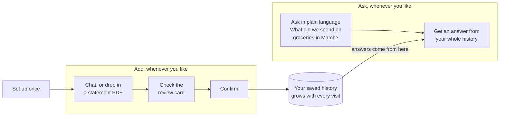
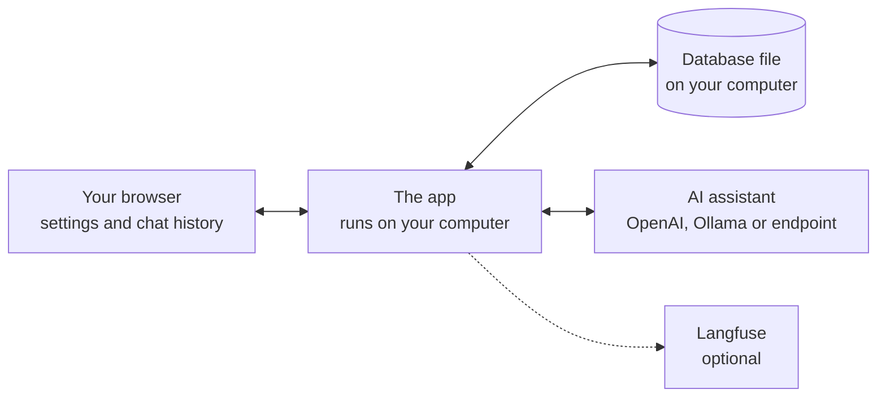
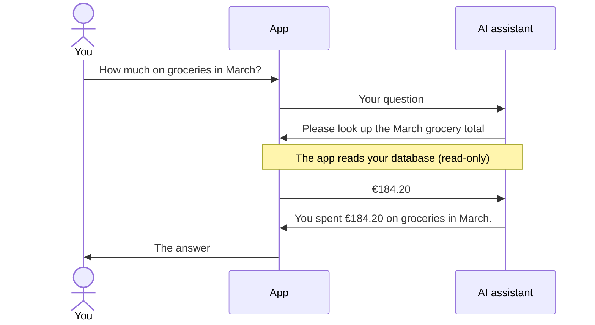
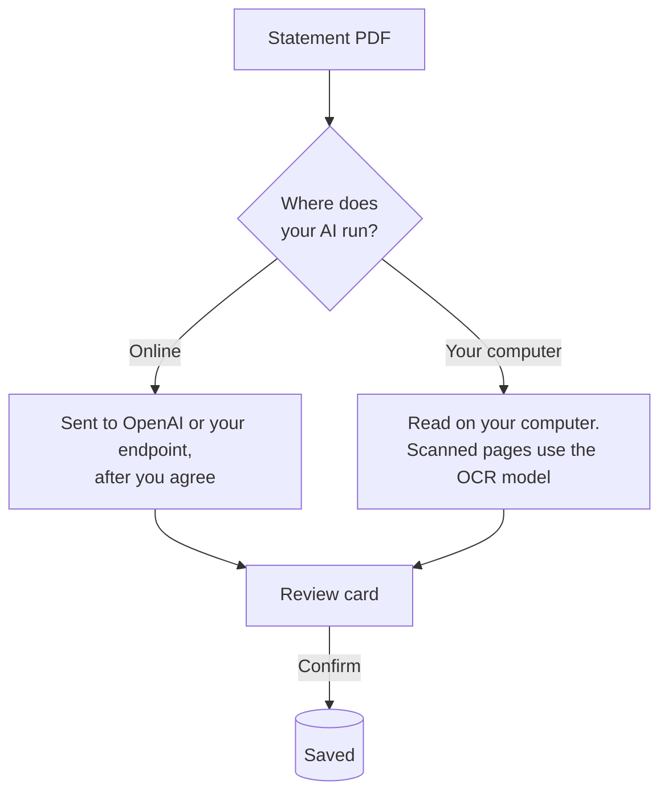

# Haushaltsbuch

A household expense tracker that runs on your own computer and keeps a lasting record of your money. Add expenses by chatting or by dropping in a bank statement PDF, then come back next week or next month and add more. Every confirmed row is saved, so your history keeps growing, and you can ask questions about all of it in plain language: *"How much did we spend on groceries in March?"* or *"Did we spend more on eating out this year than last year?"*

It is not a one-off "upload a file and ask about it" chat. Your data stays saved between visits, and every question is answered from everything you have added so far.

- **Your data stays saved, and keeps growing.** Close the app, come back later, add the next statement. Nothing is lost between visits.
- **Ask about everything you've saved.** Questions are answered from your whole history, not just the last file you uploaded.
- **Your money data stays local.** Everything is saved in one SQLite file on your computer. There is no cloud database.
- **You pick the AI.** Use OpenAI, a model on your computer (Ollama), or any OpenAI-compatible endpoint.
- **Nothing is saved without you.** The assistant only *proposes* rows. You review them and press **Confirm**, and you can undo.
- **Optional tracing.** Turn on [Langfuse](#optional-tracing-with-langfuse) to see every prompt, SQL query and model call.

---

## Quick start

You need [Git](https://git-scm.com/downloads) and [Node.js](https://nodejs.org) (version 20 or newer) installed. Then open a terminal and run these commands one at a time.

**1. Download the code** (git clone the repository) and go into its folder:

```bash
git clone https://github.com/SameerR007/haushaltsbuch.git
```

```bash
cd haushaltsbuch
```

**2. Install and start the app:**

```bash
npm install
```

```bash
npm run dev
```

**3.** Open [http://localhost:3000](http://localhost:3000) and click **Get started**. A short setup chat asks four things:

1. **Where the assistant runs:** OpenAI (API key), your computer (Ollama), or an OpenAI-compatible endpoint
2. **Currency:** EUR by default, or INR, USD, or any ISO code
3. **Your banks:** for example *Sparkasse (SP)*
4. **Confirm:** the local database is ready and the tracker opens

> **Running locally?** Install [Ollama](https://ollama.com) and pull a chat model, for example `ollama pull bonsai-2:9b`. If you want to read **scanned** statements too, also pull an OCR model such as `glm-ocr`.

---

## How you use it



After a one-time setup, you do two things, as often as you like:

- **Add.** Write *"Rent 850 on the 3rd"* or drop in this month's statement, check the review card, and press **Confirm**. Next month, add the next one. Everything goes into the same saved history, and nothing is lost between visits.
- **Ask.** Ask the chat anything about your money: *"What did we spend on rent this year?"*, *"Compare groceries in June and July"*, *"What were our five biggest expenses last quarter?"*. The answer comes from everything you have saved so far, not just the last file, so the more you add, the more you can ask.

You can also browse everything on the **Expenses** and **Summary** pages.

To pick up where you left off, run `npm run dev` again in the `haushaltsbuch` folder and open [http://localhost:3000](http://localhost:3000). Your data is still there.

| Page | What it's for |
| --- | --- |
| **Chat** | Add expenses or income in plain language, attach a statement PDF, ask questions about your money |
| **Expenses** | Every transaction, newest first. Edit any cell in place, remove a row, download as Excel |
| **Summary** | Income, expenses and net for one period, or two periods side by side, with a category chart and the largest expenses |
| **Your data** | Change the assistant or keys, add or remove banks, back up, or start over |

---

## How it works

### Where everything lives



- **Your browser** keeps your settings (including any API key) and the chat history.
- **The app** runs on your computer. It talks to the AI assistant and to the database.
- **The database** is one SQLite file on your computer. Something is only written to it when you press **Confirm**, edit a row, undo, or reset.
- **The AI assistant** is whichever one you picked during setup. It can read your data, but it cannot change it.
- **Langfuse** is only used if you turn on tracing.

### Asking a question



The AI only *asks* for data. The app checks that every query is read-only before running it.

### Adding spending

When you write *"Rent 850 on the 3rd"* or attach a statement, the AI suggests rows. The app checks them (date, category, bank, possible duplicates) and shows them on a **review card**. You can edit or remove any row. Nothing is saved until you press **Confirm**, and **Undo** removes that batch again.

### Reading a statement PDF



With an assistant on your computer, the PDF never leaves your computer. To read scanned (image-only) statements, add an OCR model such as `glm-ocr` during setup.

---

## Choosing an assistant

| | On OpenAI | On your computer | OpenAI-compatible endpoint |
| --- | --- | --- | --- |
| **You enter** | API key | Address (default `http://localhost:11434`), model, optional OCR model | Base URL, key, model |
| **Default model** | `gpt-5.6-luna` | `bonsai-2:9b` | your choice |
| **Statement PDFs** | Sent to OpenAI (asks first) | Read locally | Sent to the endpoint (asks first) |
| **Data leaves your computer?** | Prompts and query results go to OpenAI | No | Prompts and query results go to the endpoint |

Switch at any time under **Your data → Change assistant**. Your banks, currency and transactions stay.

---

## Routes

### Pages

| Route | Page |
| --- | --- |
| `/` | Welcome page with **Get started** |
| `/setup/chat` | Four-step setup chat (`?mode=keys` opens **Change keys**) |
| `/setup` | Setup card for returning visitors |
| `/chat` | Money chat: add expenses, import PDFs, ask questions |
| `/expenses` | Editable list of all transactions, Excel download |
| `/summary` | One period, or compare two periods |
| `/insights` | Placeholder (opens in a new window) |
| `/data` | **Your data**: overview and settings |
| `/data/assistant` | Change the assistant |
| `/data/banks` | Add or remove banks |
| `/data/reset` | Back up, then delete everything and start over |

Old paths (`/app/...`, `/welcome`, `/setup?mode=keys`) redirect to the ones above.

### API

All routes run on the local Next.js server. Requests that change data must come from the same origin.

| Method & route | What it does |
| --- | --- |
| **Setup** | |
| `POST /api/setup/init` | Create or migrate the local database |
| `GET  /api/setup/health` | Is the database ready? Currency and active bank count |
| `POST /api/setup/openai` | Check an OpenAI key (not stored) |
| `POST /api/setup/assistant` | Test a local model or endpoint (not stored) |
| `POST /api/setup/confirm` | Save currency and banks |
| `POST /api/setup/reset` | Delete all household data (`{ "confirm": true }`) |
| **Household & banks** | |
| `GET  /api/household` | Currency, banks, transaction counts |
| `POST /api/banks` | Add a bank, or bring a removed one back |
| `POST /api/banks/remove` | Hide a bank from new entries (its transactions stay) |
| `POST /api/banks/restore` | Make a removed bank active again |
| **Assistant** | |
| `POST /api/chat` | One chat turn: the tool loop with `run_sql` and `propose_transactions` |
| `POST /api/import/pdf` | Read a statement PDF and return a review card (multipart) |
| **Transactions** | |
| `GET    /api/transactions` | All transactions, newest first |
| `PATCH  /api/transactions/[id]` | Edit one transaction |
| `DELETE /api/transactions/[id]` | Remove one transaction |
| `POST   /api/transactions/confirm` | Save a reviewed batch |
| `POST   /api/transactions/undo` | Delete that batch again |
| **Reports & export** | |
| `GET /api/summary` | Totals for one or two date ranges |
| `GET /api/export/xlsx` | Excel file of every transaction |
| `GET /api/export/sqlite` | Backup copy of the database |

Request and response shapes: [setup](docs/setup-api.md) · [chat, import & transactions](docs/chat-api.md) · [summary](docs/summary-api.md).

---

## Configuration

Everything is optional. Put variables in `.env.local` (gitignored) or pass them on the command line.

| Variable | Default | Purpose |
| --- | --- | --- |
| `HAUSHALTSBUCH_DB_PATH` | `data/haushaltsbuch.sqlite` | Where the database file lives |
| `HAUSHALTSBUCH_CHAT_MODEL` | `gpt-5.6-luna` | OpenAI model for chat and PDF import |
| `HAUSHALTSBUCH_STUB_OPENAI` | off | Set to `1` to fake OpenAI replies for UI testing (no network) |
| `LANGFUSE_PUBLIC_KEY` / `LANGFUSE_SECRET_KEY` | unset | Turn on tracing (see below) |
| `LANGFUSE_BASE_URL` | `https://cloud.langfuse.com` | Langfuse server |

```bash
HAUSHALTSBUCH_DB_PATH=~/Documents/haushaltsbuch.sqlite npm run dev
```

---

## Optional: tracing with Langfuse

Want to see exactly what the assistant did: the prompt, every model call, each SQL query and its rows? Turn on [Langfuse](https://langfuse.com) tracing. **It's off by default**, and without keys nothing is traced or sent.

**1. Get keys.** Create a project on [Langfuse Cloud](https://cloud.langfuse.com), or [self-host it](https://langfuse.com/self-hosting), and create an API key pair.

**2. Add them to `.env.local`:**

```bash
LANGFUSE_PUBLIC_KEY="pk-lf-..."
LANGFUSE_SECRET_KEY="sk-lf-..."
LANGFUSE_BASE_URL="https://cloud.langfuse.com"   # US: https://us.cloud.langfuse.com · or your self-hosted URL
```

**3. Restart** `npm run dev`, send a chat message and open **Tracing** in Langfuse.

Each chat message and each statement import shows up as one trace. All messages from one conversation are grouped together. In a trace you can see:

- what was sent to the model, and what it answered
- each database query the model asked for, whether it was allowed, and the rows it got back
- the rows the model suggested, before and after the app checked them

> ⚠️ **Privacy:** with tracing on, prompts, SQL results (amounts, payees) and attached PDFs are sent to the Langfuse server you configured. API keys are masked. To keep everything on your computer, self-host Langfuse locally.

To turn it off, remove the two keys and restart. Full details: [docs/tracing.md](docs/tracing.md).

---

## Your data and privacy

| What | Where it's kept |
| --- | --- |
| Transactions, banks, categories, currency | SQLite file on your computer (`data/` is gitignored) |
| Assistant choice, API key, chat history | Your browser's `localStorage` |
| API key on the server | Never stored, logged, or written to the database |

- Amounts are signed: expenses are negative and income is positive.
- **Set up completely new** offers an Excel and SQLite backup first, then wipes and vacuums the file.

---

## Project layout

```
app/
  (tracker)/        chat, expenses, summary, insights pages
  setup/  data/     setup chat and "Your data" pages
  api/              all server routes (see table above)
components/         React UI (tracker, setup, data, nav)
lib/
  db.ts             SQLite schema and migrations
  llm/              model selection, tool loop, local PDF reading and OCR
  chat/             prompts, SQL guard, row validation, transactions
  data/             banks, ledger edits, summary maths, exports
  setup/            setup chat logic and guards
  tracing/          optional Langfuse integration
docs/               API and tracing reference
```

## Development

```bash
npm test        # schema, SQL guard, confirm/undo, PDF import, summaries, tracing
npm run lint
npm run build
```

Built with Next.js 15, React 19, the Vercel AI SDK, better-sqlite3 and unpdf.
