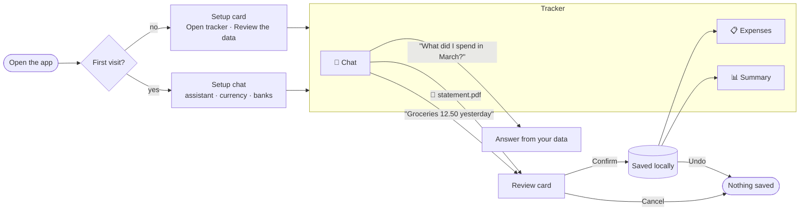
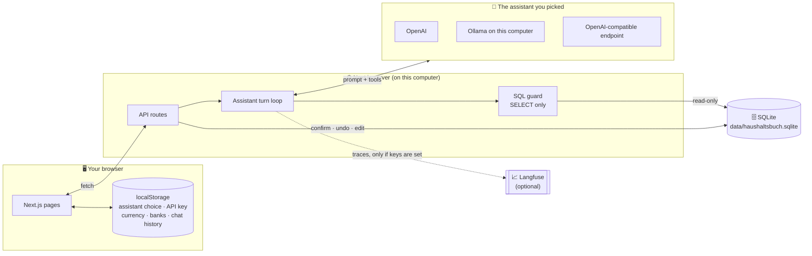
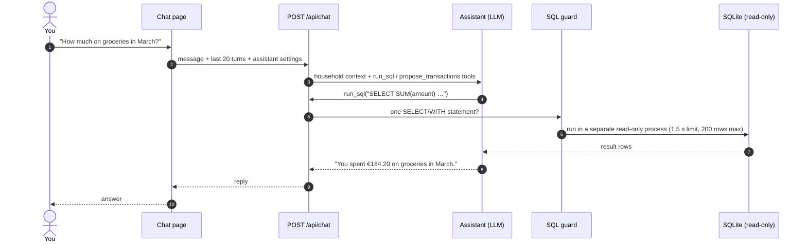
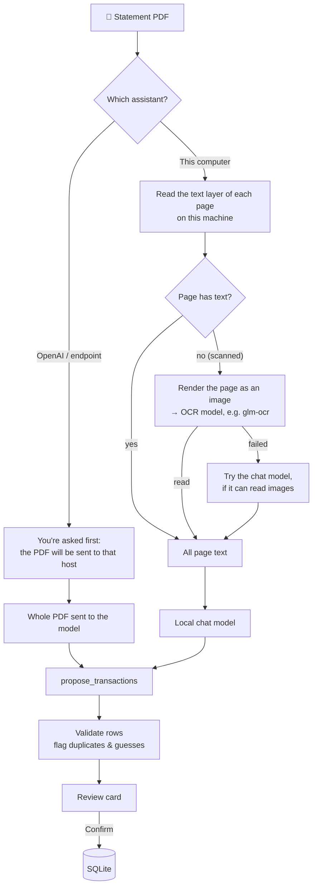

# Haushaltsbuch

A household expense tracker that runs on your own computer. You add expenses by chatting or by dropping in a bank statement PDF. You ask questions like *"How much did we spend on groceries in March?"* in plain language.

- **Your money data stays local.** Everything is saved in one SQLite file on this machine. There is no cloud database.
- **You pick the AI.** Use OpenAI, a model on this computer (Ollama), or any OpenAI-compatible endpoint.
- **Nothing is saved without you.** The assistant only *proposes* rows. You review them and press **Confirm**, and you can undo.
- **Optional tracing.** Turn on [Langfuse](#optional-tracing-with-langfuse) to see every prompt, SQL query and model call.

---

## Quick start

```bash
npm install
npm run dev
```

Open [http://localhost:3000](http://localhost:3000) and click **Get started**. A short setup chat asks four things:

1. **Where the assistant runs:** OpenAI (API key), this computer (Ollama), or an OpenAI-compatible endpoint
2. **Currency:** EUR by default, or INR, USD, or any ISO code
3. **Your banks:** for example *Sparkasse (SP)*
4. **Confirm:** the local database is ready and the tracker opens

> **Running locally?** Install [Ollama](https://ollama.com) and pull a chat model, for example `ollama pull gemma4:12b-mlx` (the `-mlx` build is for Apple silicon). If you want to read **scanned** statements too, also pull an OCR model such as `glm-ocr`.

---

## How you use it



| Page | What it's for |
| --- | --- |
| **Chat** | Add expenses or income in plain language, attach a statement PDF, ask questions about your money |
| **Expenses** | Every transaction, newest first. Edit any cell in place, remove a row, download as Excel |
| **Summary** | Income, expenses and net for one period, or two periods side by side, with a category donut and the largest expenses |
| **Your data** | Change the assistant or keys, add or remove banks, back up, or start over |

---

## How it works

### Where everything lives



- **The browser** keeps the assistant settings (including any API key) and the chat history. The key is sent with each request and never stored on the server.
- **The server** builds the prompt, runs the tool loop and talks to SQLite.
- **SQLite** holds categories, banks, transactions and your currency. Only the server writes to it, and only after you press **Confirm**, edit, undo or reset.

### What happens when you ask a question



When you *add* something ("Rent 850 on the 3rd"), the model calls `propose_transactions` instead. The server checks those rows (dates, categories, banks, possible duplicates) and returns a **review card**. Nothing is written until you press **Confirm**. That calls `POST /api/transactions/confirm`, and **Undo** deletes exactly that batch.

### How a statement PDF is read



With a local assistant the PDF never leaves your computer. Without an OCR model, scanned pages are skipped unless the chat model can read images.

---

## Choosing an assistant

| | On OpenAI | On this computer | OpenAI-compatible endpoint |
| --- | --- | --- | --- |
| **You enter** | API key | Address (default `http://localhost:11434`), model, optional OCR model | Base URL, key, model |
| **Default model** | `gpt-5.6-luna` | `gemma4:12b-mlx` | your choice |
| **Statement PDFs** | Sent to OpenAI (asks first) | Read locally | Sent to the endpoint (asks first) |
| **Data leaves the machine?** | Prompts and query results go to OpenAI | No | Prompts and query results go to the endpoint |

Switch at any time under **Your data → Change assistant**. Your banks, currency and transactions stay.

---

## Routes

### Pages

| Route | Page |
| --- | --- |
| `/` | Welcome page with **Get started** |
| `/setup/chat` | Four-step setup chat (`?mode=keys` opens **Change keys**) |
| `/setup` | Setup card for returning visitors |
| `/chat` | Money chat: add expenses, import PDFs, ask questions |
| `/expenses` | Editable list of all transactions, Excel download |
| `/summary` | One period, or compare two periods |
| `/insights` | Placeholder (opens in a new window) |
| `/data` | **Your data**: overview and settings |
| `/data/assistant` | Change the assistant |
| `/data/banks` | Add or remove banks |
| `/data/reset` | Back up, then delete everything and start over |

Old paths (`/app/...`, `/welcome`, `/setup?mode=keys`) redirect to the ones above.

### API

All routes run on the local Next.js server. Requests that change data must come from the same origin.

| Method & route | What it does |
| --- | --- |
| **Setup** | |
| `POST /api/setup/init` | Create or migrate the local database |
| `GET  /api/setup/health` | Is the database ready? Currency and active bank count |
| `POST /api/setup/openai` | Check an OpenAI key (not stored) |
| `POST /api/setup/assistant` | Test a local model or endpoint (not stored) |
| `POST /api/setup/confirm` | Save currency and banks |
| `POST /api/setup/reset` | Delete all household data (`{ "confirm": true }`) |
| **Household & banks** | |
| `GET  /api/household` | Currency, banks, transaction counts |
| `POST /api/banks` | Add a bank, or bring a removed one back |
| `POST /api/banks/remove` | Hide a bank from new entries (its transactions stay) |
| `POST /api/banks/restore` | Make a removed bank active again |
| **Assistant** | |
| `POST /api/chat` | One chat turn: the tool loop with `run_sql` and `propose_transactions` |
| `POST /api/import/pdf` | Read a statement PDF and return a review card (multipart) |
| **Transactions** | |
| `GET    /api/transactions` | All transactions, newest first |
| `PATCH  /api/transactions/[id]` | Edit one transaction |
| `DELETE /api/transactions/[id]` | Remove one transaction |
| `POST   /api/transactions/confirm` | Save a reviewed batch |
| `POST   /api/transactions/undo` | Delete that batch again |
| **Reports & export** | |
| `GET /api/summary` | Totals for one or two date ranges |
| `GET /api/export/xlsx` | Excel file of every transaction |
| `GET /api/export/sqlite` | Backup copy of the database |

Request and response shapes: [setup](docs/setup-api.md) · [chat, import & transactions](docs/chat-api.md) · [summary](docs/summary-api.md).

---

## Configuration

Everything is optional. Put variables in `.env.local` (gitignored) or pass them on the command line.

| Variable | Default | Purpose |
| --- | --- | --- |
| `HAUSHALTSBUCH_DB_PATH` | `data/haushaltsbuch.sqlite` | Where the database file lives |
| `HAUSHALTSBUCH_CHAT_MODEL` | `gpt-5.6-luna` | OpenAI model for chat and PDF import |
| `HAUSHALTSBUCH_STUB_OPENAI` | off | Set to `1` to fake OpenAI replies for UI testing (no network) |
| `LANGFUSE_PUBLIC_KEY` / `LANGFUSE_SECRET_KEY` | unset | Turn on tracing (see below) |
| `LANGFUSE_BASE_URL` | `https://cloud.langfuse.com` | Langfuse server |

```bash
HAUSHALTSBUCH_DB_PATH=~/Documents/haushaltsbuch.sqlite npm run dev
```

---

## Optional: tracing with Langfuse

Want to see exactly what the assistant did: the prompt, every model call, each SQL query and its rows? Turn on [Langfuse](https://langfuse.com) tracing. **It's off by default**, and without keys nothing is traced or sent.

**1. Get keys.** Create a project on [Langfuse Cloud](https://cloud.langfuse.com), or [self-host it](https://langfuse.com/self-hosting), and create an API key pair.

**2. Add them to `.env.local`:**

```bash
LANGFUSE_PUBLIC_KEY="pk-lf-..."
LANGFUSE_SECRET_KEY="sk-lf-..."
LANGFUSE_BASE_URL="https://cloud.langfuse.com"   # US: https://us.cloud.langfuse.com · or your self-hosted URL
```

**3. Restart** `npm run dev`, send a chat message and open **Tracing** in Langfuse.

Each chat message becomes a `chat-turn` trace and each statement a `pdf-import` trace. All turns of one conversation are grouped into one Langfuse **session**.

```
chat-turn
└─ invoke_agent
   ├─ chat <model>          prompt, messages, tokens
   ├─ execute_tool run_sql
   │  ├─ sql-guard          allowed or rejected
   │  └─ sql-execute        rows returned
   └─ chat <model>          final answer
└─ review-rows              proposed rows → validated rows
```

> ⚠️ **Privacy:** with tracing on, prompts, SQL results (amounts, payees) and attached PDFs are sent to the Langfuse server you configured. API keys are masked. To keep everything on this machine, self-host Langfuse locally.

To turn it off, remove the two keys and restart. Full details: [docs/tracing.md](docs/tracing.md).

---

## Your data and privacy

| What | Where it's kept |
| --- | --- |
| Transactions, banks, categories, currency | SQLite file on this computer (`data/` is gitignored) |
| Assistant choice, API key, chat history | Your browser's `localStorage` |
| API key on the server | Never stored, logged, or written to the database |

- Amounts are signed: expenses are negative and income is positive.
- The assistant can only **read** the database through a guarded, read-only `SELECT`. All writes go through Confirm, edits, Undo or Reset.
- **Set up completely new** offers an Excel and SQLite backup first, then wipes and vacuums the file.

---

## Project layout

```
app/
  (tracker)/        chat, expenses, summary, insights pages
  setup/  data/     setup chat and "Your data" pages
  api/              all server routes (see table above)
components/         React UI (tracker, setup, data, nav)
lib/
  db.ts             SQLite schema and migrations
  llm/              model selection, tool loop, local PDF reading and OCR
  chat/             prompts, SQL guard, row validation, transactions
  data/             banks, ledger edits, summary maths, exports
  setup/            setup chat logic and guards
  tracing/          optional Langfuse integration
docs/               API and tracing reference
```

## Development

```bash
npm test        # schema, SQL guard, confirm/undo, PDF import, summaries, tracing
npm run lint
npm run build
```

Built with Next.js 15, React 19, the Vercel AI SDK, better-sqlite3 and unpdf.
